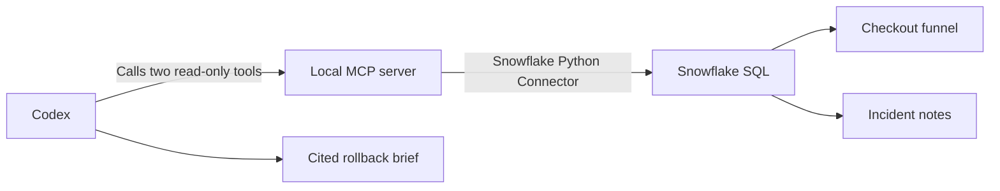

# Launch-Day Mystery

**An AI-assisted incident investigation backed by live Snowflake queries.**

A fictional retailer enables one-tap checkout for a group of iOS shoppers at **10:00 UTC**. In the next hour, orders fall **18%** even though traffic stays steady. A payment-provider alert comes in. The incident lead has to decide whether to roll back the release.

> **Verified on a Snowflake trial.** Codex called two local MCP tools, retrieved live cohort metrics and incident notes from Snowflake, and produced a cited rollback brief.

## The evidence

| iOS cohort | Checkout starts before → after | Orders before → after | Completion before → after | Logged timeouts before → after |
| --- | ---: | ---: | ---: | ---: |
| Rollout · new flow after 10:00 | 500 → 500 | 300 → 120 | **60.0% → 24.0%** | **8 → 120** |
| Holdout · stayed on the old flow | 165 → 165 | 100 → 100 | 60.6% → 60.6% | 8 → 8 |

The Snowflake event table represents **14,000 synthetic shopper sessions** across two hours. Each shopper journey can include a storefront visit, checkout start, and order or timeout. The payment alert (`PAY-017`) starts at **11:20 UTC**, after the **10:00–11:00 UTC** investigation window.

## How it works



| Component | Responsibility |
| --- | --- |
| **Snowflake** | Stores shopper events and incident notes. SQL calculates the funnel from events. |
| **[Local MCP server](mcp/incident_server.py)** | Gives Codex two fixed SQL tools through a dedicated Snowflake reader role. |
| **Codex** | Interprets the returned rows, cites the timeline evidence, and proposes a recovery check. |

This trial path uses Snowflake SQL for data access and Codex for model inference. The [Snowflake-native deployment](#snowflake-native-deployment) includes Cortex and Streamlit for accounts with those features enabled.

## Local MCP setup

You’ll need Snowsight access to a Snowflake account, Snowflake CLI, Codex, and [uv](https://docs.astral.sh/uv/). Run the setup scripts in a Snowflake account where you can create the named demo objects.

### 1. Load the data

In Snowsight, open a SQL file. Run each script in full and in this order:

1. [01_setup.sql](sql/01_setup.sql) creates the database, X-Small warehouse, and seed tables.
2. [02_seed.sql](sql/02_seed.sql) loads the synthetic checkout totals and incident notes.
3. [02b_events.sql](sql/02b_events.sql) generates individual shopper events and creates the funnel view.

### 2. Create the reader role

Run the statements below with an admin role. Replace `YOUR_SNOWFLAKE_USER` with the exact result of `SELECT CURRENT_USER();`.

```sql
CREATE ROLE IF NOT EXISTS LAUNCH_MYSTERY_MCP_READER;

GRANT USAGE ON DATABASE LAUNCH_MYSTERY TO ROLE LAUNCH_MYSTERY_MCP_READER;
GRANT USAGE ON SCHEMA LAUNCH_MYSTERY.DEMO TO ROLE LAUNCH_MYSTERY_MCP_READER;
GRANT USAGE ON WAREHOUSE LAUNCH_MYSTERY_WH TO ROLE LAUNCH_MYSTERY_MCP_READER;
GRANT SELECT ON VIEW LAUNCH_MYSTERY.DEMO.CHECKOUT_EVENT_FUNNEL TO ROLE LAUNCH_MYSTERY_MCP_READER;
GRANT SELECT ON TABLE LAUNCH_MYSTERY.DEMO.INCIDENT_NOTES TO ROLE LAUNCH_MYSTERY_MCP_READER;

GRANT ROLE LAUNCH_MYSTERY_MCP_READER TO USER "YOUR_SNOWFLAKE_USER";
```

### 3. Verify browser sign-in and SQL

Set `YOUR_ACCOUNT_IDENTIFIER` and `YOUR_SNOWFLAKE_USER` before running these commands. The account identifier usually takes the form `organization-account`. `OAUTH_AUTHORIZATION_CODE` uses Snowflake’s browser sign-in flow, including Google sign-in when offered by the account. [Snowflake OAuth for local applications](https://docs.snowflake.com/en/user-guide/oauth-local-applications)

```bash
snow connection add --no-interactive \
  --connection-name launch_mystery_oauth \
  --account YOUR_ACCOUNT_IDENTIFIER \
  --user YOUR_SNOWFLAKE_USER \
  --authenticator OAUTH_AUTHORIZATION_CODE \
  --role LAUNCH_MYSTERY_MCP_READER \
  --warehouse LAUNCH_MYSTERY_WH \
  --database LAUNCH_MYSTERY \
  --schema DEMO

snow connection test -c launch_mystery_oauth
snow sql -c launch_mystery_oauth -q 'SELECT CURRENT_ROLE() AS active_role, COUNT(*) AS funnel_rows FROM LAUNCH_MYSTERY.DEMO.CHECKOUT_EVENT_FUNNEL'
```

The SQL command should return `LAUNCH_MYSTERY_MCP_READER` and `8`. A browser confirmation means sign-in worked. The result table in Terminal confirms the query ran.

### 4. Add the local MCP server to Codex

From the repository root, run:

```bash
codex mcp add launch-day-mystery-local -- "$(command -v uv)" run --script "$(pwd)/mcp/incident_server.py"
```

On macOS, if Terminal reports `codex: command not found`, use the desktop app’s bundled CLI:

```bash
"/Applications/ChatGPT.app/Contents/Resources/codex-cli/CodexCLI.app/Contents/MacOS/codex" \
  mcp add launch-day-mystery-local -- "$(command -v uv)" run --script "$(pwd)/mcp/incident_server.py"
```

Open a **new Codex chat**. Complete browser sign-in if Snowflake prompts during a tool call.

## MCP tools and verification

| Tool | Snowflake source | Expected result |
| --- | --- | --- |
| `compare_ios_checkout` | `LAUNCH_MYSTERY.DEMO.CHECKOUT_EVENT_FUNNEL` | Four iOS cohort and phase rows with checkout starts, orders, completion percentage, and timeout counts |
| `read_incident_notes` | `LAUNCH_MYSTERY.DEMO.INCIDENT_NOTES` | Synthetic notes with stable document IDs, titles, and text |

Call both tools from a fresh Codex chat to verify the connection. Compare the cohort rows with the evidence table above and confirm the note results include `REL-041` and `PAY-017`. Both tools use fixed SELECT statements and run with the demo reader role.

## Snowflake-native deployment

For an AI-enabled Snowflake account, connect the incident room to **Cortex Search**, **Cortex AI SQL**, and **Streamlit in Snowflake**. The same event-derived funnel is exposed to **Cortex Analyst** through a semantic view in Snowsight. The Streamlit app includes a shopper event trace and checks generated quotes against the retrieved notes.

```bash
snow connection test -c my_admin_connection
bash deploy.sh my_admin_connection
```

Open `LAUNCH_MYSTERY.DEMO.INCIDENT_ROOM` in Snowsight. The deploy script runs checks for checkout totals, the semantic view, Search, and model access. This path is included in the repo and still needs an end-to-end run on an AI-enabled account. The [managed MCP setup](docs/managed-mcp.md) records the separate account limitation observed during testing.

## Tests and cleanup

```bash
python3 -m unittest discover -s tests -v
```

The local suite checks the seeded metrics and citation validation. The demo warehouse auto-suspends after 60 seconds. To remove the dedicated demo database, warehouse, role, and optional OAuth integration, review [99_cleanup.sql](sql/99_cleanup.sql) and run it as an admin when you’re done.
